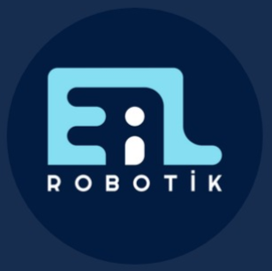

<a id="readme-top"></a>

<!-- PROJECT SHIELDS -->
[![Contributors][contributors-shield]][contributors-url]
[![Forks][forks-shield]][forks-url]
[![Stargazers][stars-shield]][stars-url]
[![Issues][issues-shield]][issues-url]
[![License][license-shield]][license-url]
[![Website][website-shield]][website-url]

<!-- PROJECT LOGO -->
<br />
<div align="center">
  <a href="https://ealrobotik.com/">
    
  </a>

  <h3 align="center">EAL Robotik - Flare #8828</h3>

  <p align="center">
    Official website and web portal for EAL Robotik (FIRST Robotics Competition Team #8828).
    <br />
    <a href="https://ealrobotik.com/"><strong>Explore the live site »</strong></a>
    <br />
    <br />
    <a href="https://ealrobotik.com/">View Demo</a>
    &middot;
    <a href="https://github.com/Luxotick/ealrobotik/issues/new?labels=bug&template=bug-report---.md">Report Bug</a>
    &middot;
    <a href="https://github.com/Luxotick/ealrobotik/issues/new?labels=enhancement&template=feature-request---.md">Request Feature</a>
  </p>
</div>

<!-- TABLE OF CONTENTS -->
<details>
  <summary>Table of Contents</summary>
  <ol>
    <li>
      <a href="#about-the-project">About The Project</a>
      <ul>
        <li><a href="#built-with">Built With</a></li>
      </ul>
    </li>
    <li>
      <a href="#getting-started">Getting Started</a>
      <ul>
        <li><a href="#prerequisites">Prerequisites</a></li>
        <li><a href="#installation">Installation</a></li>
      </ul>
    </li>
    <li><a href="#usage">Usage</a></li>
    <li><a href="#roadmap">Roadmap</a></li>
    <li><a href="#contributing">Contributing</a></li>
    <li><a href="#license">License</a></li>
    <li><a href="#contact">Contact</a></li>
    <li><a href="#acknowledgments">Acknowledgments</a></li>
  </ol>
</details>

<!-- ABOUT THE PROJECT -->
## About The Project

[![EAL Robotik Website Screenshot][product-screenshot]](https://ealrobotik.com/)

EAL Robotik (Flare #8828) is a FIRST Robotics Competition (FRC) team founded at Eskişehir Anadolu Lisesi. This repository contains the official web application for the team, showcasing team milestones, competition performances, ecosystem partners, technical resources, and social responsibility initiatives.

Key features of the portal:
* Sustainable FRC team vision combining academic excellence and community impact.
* Season-by-season performance metrics, playoff results, and interactive timeline gallery.
* Ecosystem directory acknowledging institutional, alumni, and private sector sponsors.
* Curated learning hub for software development (WPILib, RobotPy, Python) and mechanical CAD design (Fusion 360).
* Highlights for social impact initiatives such as *Waves of Innovation* and *Girls of Innovation*.

Visit the active website at [https://ealrobotik.com/](https://ealrobotik.com/).

<p align="right">(<a href="#readme-top">back to top</a>)</p>

### Built With

* [![Next][Next.js]][Next-url]
* [![React][React.js]][React-url]
* [![TypeScript][TypeScript.ts]][TypeScript-url]
* [![Tailwind][Tailwind.css]][Tailwind-url]

<p align="right">(<a href="#readme-top">back to top</a>)</p>

<!-- GETTING STARTED -->
## Getting Started

Follow these steps to set up and run a local development instance of the project.

### Prerequisites

Ensure Node.js (v18 or higher) and npm are installed on your machine.
* npm
  ```sh
  npm install npm@latest -g
  ```

### Installation

1. Clone the repository
   ```sh
   git clone https://github.com/Luxotick/ealrobotik.git
   ```
2. Navigate to the project directory
   ```sh
   cd ealrobotik
   ```
3. Install dependencies
   ```sh
   npm install
   ```
   *(Alternatively, run `setup.bat` on Windows or `./setup.sh` on Unix-like systems)*
4. Start the development server
   ```sh
   npm run dev
   ```
   *(Alternatively, run `start.bat` on Windows or `./start.sh` on Unix-like systems)*
5. Open [http://localhost:3000](http://localhost:3000) in your browser.

<p align="right">(<a href="#readme-top">back to top</a>)</p>

<!-- USAGE EXAMPLES -->
## Usage

Below are the primary commands for building and running the application:

* Start development server:
  ```sh
  npm run dev
  ```
* Build production bundle:
  ```sh
  npm run build
  ```
* Start production server:
  ```sh
  npm run start
  ```
* Run linter:
  ```sh
  npm run lint
  ```

Active website: [https://ealrobotik.com/](https://ealrobotik.com/)

<p align="right">(<a href="#readme-top">back to top</a>)</p>

<!-- ROADMAP -->
## Roadmap

- [x] Modern responsive UI with dark mode support
- [x] Season timeline and media gallery integration
- [x] Ecosystem and sponsor showcase
- [x] Educational resource directory and documentation links
- [x] Integration of social responsibility projects (*Waves of Innovation*, *Girls of Innovation*)
- [ ] Interactive 3D robot model showcase
- [ ] English / Turkish multi-language switcher

See the [open issues](https://github.com/Luxotick/ealrobotik/issues) for a full list of proposed features and issue tracking.

<p align="right">(<a href="#readme-top">back to top</a>)</p>

<!-- CONTRIBUTING -->
## Contributing

Contributions are what make the open-source community such an inspiring place to learn and create. Any contributions to the EAL Robotik repository are **greatly appreciated**.

To contribute:
1. Fork the Project
2. Create your Feature Branch (`git checkout -b feature/AmazingFeature`)
3. Commit your Changes (`git commit -m 'Add some AmazingFeature'`)
4. Push to the Branch (`git push origin feature/AmazingFeature`)
5. Open a Pull Request

### Top contributors:

<a href="https://github.com/Luxotick/ealrobotik/graphs/contributors">
  
</a>

<p align="right">(<a href="#readme-top">back to top</a>)</p>

<!-- LICENSE -->
## License

Distributed under the MIT License. See `LICENSE` for more details.

<p align="right">(<a href="#readme-top">back to top</a>)</p>

<!-- CONTACT -->
## Contact

EAL Robotik - [@ealrobotik_8828](https://www.instagram.com/ealrobotik_8828) - info@ealrobotik.com

Active Website: [https://ealrobotik.com/](https://ealrobotik.com/)  
Project Link: [https://github.com/Luxotick/ealrobotik](https://github.com/Luxotick/ealrobotik)

<p align="right">(<a href="#readme-top">back to top</a>)</p>

<!-- ACKNOWLEDGMENTS -->
## Acknowledgments

* [FIRST Robotics Competition](https://www.firstinspires.org/robotics/frc)
* [Fikret Yüksel Foundation](https://www.fikretyukselfoundation.org/)
* [Eskişehir Anadolu Lisesi](https://eal.meb.k12.tr/)
* [The Blue Alliance](https://www.thebluealliance.com/team/8828)
* [Img Shields](https://shields.io)

<p align="right">(<a href="#readme-top">back to top</a>)</p>

<!-- MARKDOWN LINKS & IMAGES -->
[contributors-shield]: https://img.shields.io/github/contributors/Luxotick/ealrobotik.svg?style=for-the-badge
[contributors-url]: https://github.com/Luxotick/ealrobotik/graphs/contributors
[forks-shield]: https://img.shields.io/github/forks/Luxotick/ealrobotik.svg?style=for-the-badge
[forks-url]: https://github.com/Luxotick/ealrobotik/network/members
[stars-shield]: https://img.shields.io/github/stars/Luxotick/ealrobotik.svg?style=for-the-badge
[stars-url]: https://github.com/Luxotick/ealrobotik/stargazers
[issues-shield]: https://img.shields.io/github/issues/Luxotick/ealrobotik.svg?style=for-the-badge
[issues-url]: https://github.com/Luxotick/ealrobotik/issues
[license-shield]: https://img.shields.io/github/license/Luxotick/ealrobotik.svg?style=for-the-badge
[license-url]: https://github.com/Luxotick/ealrobotik/blob/main/LICENSE
[website-shield]: https://img.shields.io/badge/Website-ealrobotik.com-success?style=for-the-badge&logo=googlechrome&logoColor=white
[website-url]: https://ealrobotik.com/
[product-screenshot]: public/ealrobotik.png
[Next.js]: https://img.shields.io/badge/next.js-000000?style=for-the-badge&logo=nextdotjs&logoColor=white
[Next-url]: https://nextjs.org/
[React.js]: https://img.shields.io/badge/React-20232A?style=for-the-badge&logo=react&logoColor=61DAFB
[React-url]: https://reactjs.org/
[Tailwind.css]: https://img.shields.io/badge/Tailwind_CSS-38B2AC?style=for-the-badge&logo=tailwind-css&logoColor=white
[Tailwind-url]: https://tailwindcss.com/
[TypeScript.ts]: https://img.shields.io/badge/TypeScript-007ACC?style=for-the-badge&logo=typescript&logoColor=white
[TypeScript-url]: https://www.typescriptlang.org/
